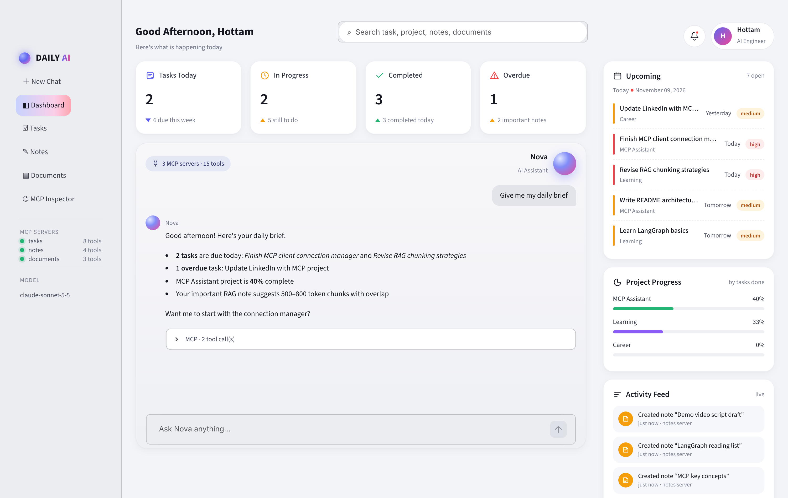
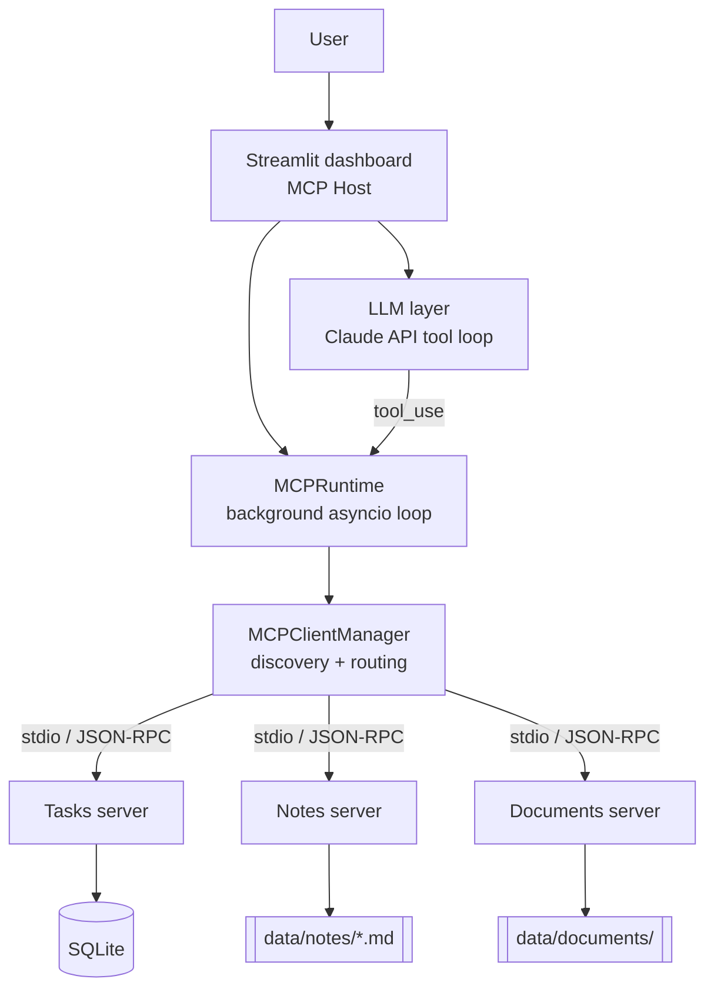

# Nova — AI Personal Productivity Assistant using MCP

A dashboard-style AI assistant that manages **tasks**, **notes** and **documents** through the
**Model Context Protocol (MCP)**. Claude decides *what* to do; MCP servers do it.



> "Create a task to learn LangGraph tomorrow" → Claude picks `tasks__create_task` → the MCP client
> routes it to the Tasks server → SQLite is updated → the dashboard refreshes.

## Features

| Area | What it does |
|---|---|
| **Dashboard** | Greeting, global search, KPI cards (due today / in progress / completed / overdue), chat with the assistant, upcoming tasks, project progress, live activity feed |
| **Chat** | Claude + MCP tool-calling loop; every tool call is visible (name, arguments, result, latency) |
| **Tasks** | Kanban board (To do / In progress / Done), project filter, create/start/complete/delete — all via MCP tools |
| **Notes** | Markdown notes with tags + ★ important flag; keyword search |
| **Documents** | Upload TXT/MD/PDF, ranked passage search (TF-IDF) |
| **MCP Inspector** | Live view of servers, tools + JSON schemas, resources and prompts; call any tool by hand |

## Architecture



**Key idea:** MCP is the *communication protocol*; the LLM does the *reasoning*. Claude's native
tool calling is how the model *asks* for an action. MCP is how the app *discovers* and *executes*
that action on a server. The servers here also work unchanged with Claude Desktop, Cursor or any
other MCP host.

### MCP capabilities exposed

| Server | Tools | Resources | Prompts |
|---|---|---|---|
| `tasks` | `get_today`, `create_task`, `list_tasks`, `update_task`, `complete_task`, `delete_task`, `task_stats`, `recent_activity` | `tasks://stats`, `tasks://open` | `weekly_summary`, `plan_my_day` |
| `notes` | `create_note`, `search_notes`, `get_note`, `update_note` | `notes://all`, `notes://{note_id}` | `study_plan` |
| `documents` | `list_documents`, `search_documents`, `read_document` | `docs://index` | `explain_architecture` |

Full input schemas are generated from the type hints and docstrings. You can browse them in the **MCP Inspector** page.

## Project structure

```
app/          main.py (Streamlit host) · cli.py (terminal chat) · config.py · seed.py
mcp_client/   manager.py (connections, discovery, routing) · runtime.py (async ↔ Streamlit bridge)
servers/      tasks_server.py · notes_server.py · documents_server.py
database/     db.py (SQLite) · notes_store.py · doc_search.py · models.py (Pydantic validation)
llm/          agent.py (Claude tool-calling loop)
ui/           styles.py (CSS) · components.py (card builders)
tests/        unit + integration tests (real MCP servers over stdio)
```

## Setup (Windows)

Quickest: double-click **`run.bat`**. It creates a venv, installs the requirements, seeds demo data and opens the app.

Manual:

```powershell
python -m venv .venv
.venv\Scripts\activate
pip install -r requirements.txt
copy .env.example .env        # then paste your ANTHROPIC_API_KEY
python -m app.seed            # optional demo data
streamlit run app\main.py
```

macOS/Linux: same steps with `source .venv/bin/activate` and `cp`.

Requires **Python 3.10+** and the MCP Python SDK **v2** (`mcp>=2.3`). In v2, `FastMCP` was renamed
`MCPServer` (`from mcp.server.mcpserver import MCPServer`).

## Other ways to run

```bash
python -m app.cli                       # terminal chat, prints every tool call
python -m servers.tasks_server          # run one server alone (stdio)
mcp dev servers/tasks_server.py         # official MCP Inspector in the browser
python -m pytest -q                     # 15 unit + integration tests
```

### Use the servers from Claude Desktop

Add this to `claude_desktop_config.json` (adjust the path):

```json
{
  "mcpServers": {
    "tasks": {
      "command": "E:\\MCP_linkdin\\mcp-productivity-assistant\\.venv\\Scripts\\python.exe",
      "args": ["-m", "servers.tasks_server"],
      "cwd": "E:\\MCP_linkdin\\mcp-productivity-assistant",
      "env": { "PYTHONPATH": "E:\\MCP_linkdin\\mcp-productivity-assistant" }
    }
  }
}
```

## Engineering notes

- **Secrets:** API key only from `.env` (git-ignored).
- **Validation:** Pydantic models validate every tool input. Bad input returns `{"ok": false, "error": ...}` so the LLM can recover instead of crashing.
- **Safety:** notes/doc paths are checked against traversal; the tool loop is capped (`MAX_TOOL_ROUNDS`); HTML output is escaped.
- **Resilience:** if one server fails to start, it is marked disconnected and the others keep working.
- **Async:** one background event loop owns all MCP sessions, so Streamlit reruns don't reconnect.
- **Logging:** servers log to **stderr** (stdout is reserved for the protocol).

## Roadmap

PDF OCR · embeddings-based RAG in the documents server · Streamable HTTP transport · calendar server · auth.

See **[LEARNING.md](LEARNING.md)** for a phase-by-phase walkthrough with exercises, and
**[docs/DEMO_SCRIPT.md](docs/DEMO_SCRIPT.md)** for a 2-minute demo video script.
